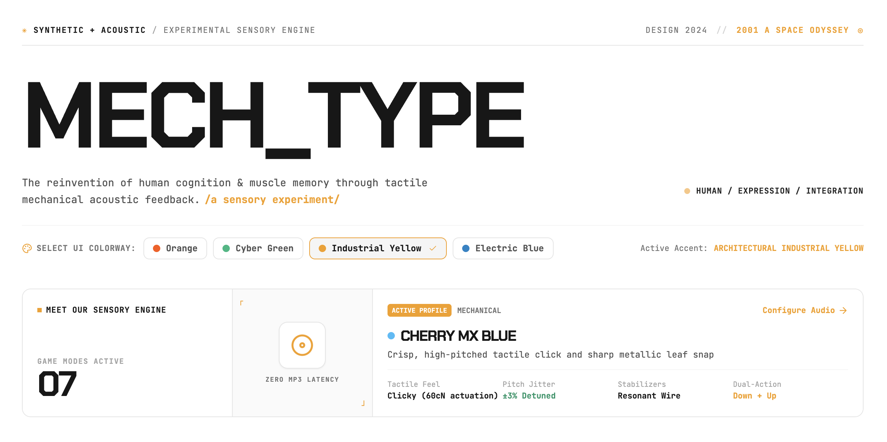
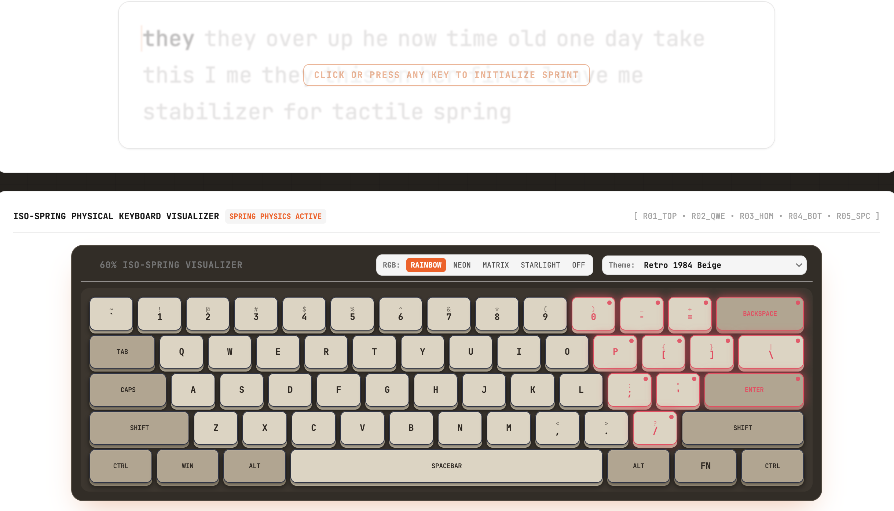
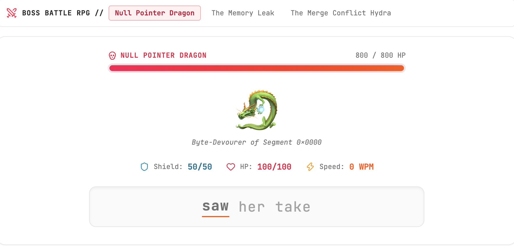
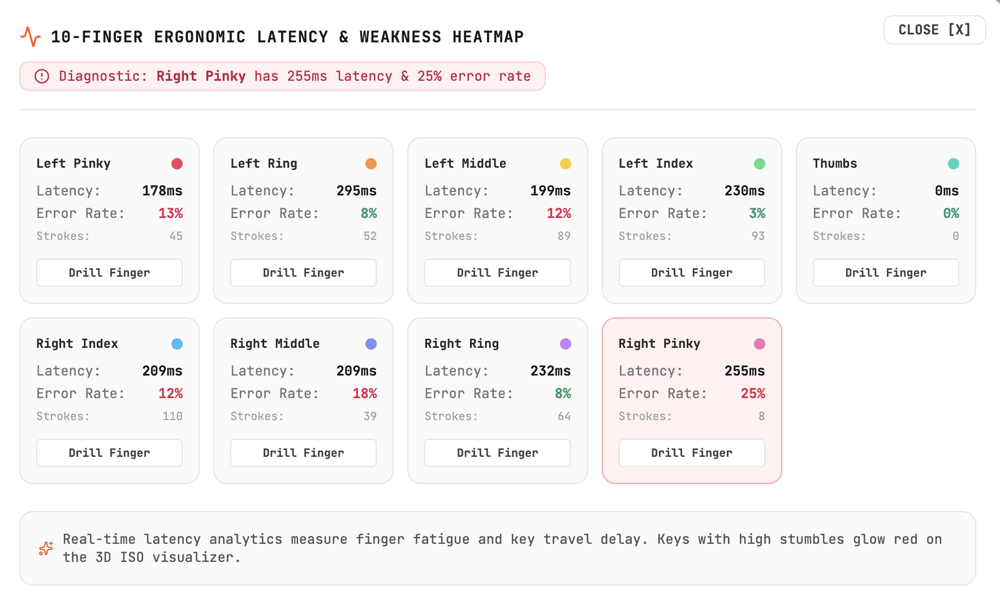
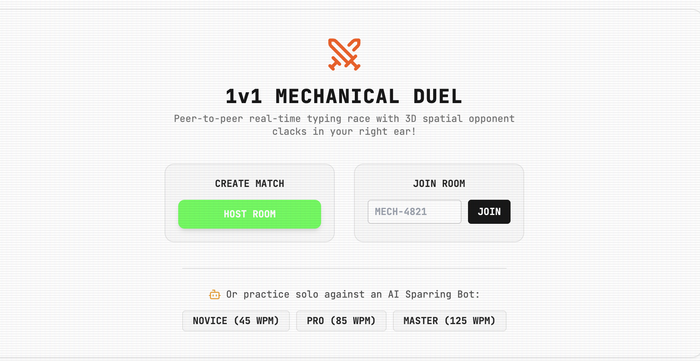

<div align="center">

```text
  __  __ _____ ____ _   _ _____ _   _ ____  _____ 
 |  \/  | ____/ ___| | | |_   _| | | |  _ \| ____|
 | |\/| |  _|| |   | |_| | | | | |_| | |_) |  _|  
 | |  | | |__| |___|  _  | | |  \__, |  __/| |___ 
 |_|  |_|_____\____|_| |_| |_|    |_/|_|   |_____|
           // SENSORY LAB • 2024 //
```

# ⌨️ `M E C H _ T Y P E`
### **The Sensory Mechanical Keyboard Typing Trainer, ASMR Sound Engine & Arcade Rhythm Game**

<p align="center">
  <em>The reinvention of human muscle memory and touch-typing benchmarking through tactile acoustic feedback.</em>
</p>

<!-- Sleek for-the-badge badges with color-coded branding -->
<p align="center">
  <a href="https://react.dev/"></a>
  <a href="https://www.typescriptlang.org/"></a>
  <a href="https://vitejs.dev/"></a>
  <a href="https://tailwindcss.com/"></a>
  <a href="https://developer.mozilla.org/en-US/docs/Web/API/Web_Audio_API"></a>
  <a href="#"></a>
  <a href="#"></a>
  <a href="LICENSE"></a>
</p>

<p align="center">
  <a href="#-12--quickstart--local-setup"><b>⚡ Quickstart</b></a> •
  <a href="#-01--visual-tour--architectural-interface"><b>🖼️ Visual Tour</b></a> •
  <a href="#-02--zero-latency-asmr-switch-engine"><b>🔊 Switch Acoustics</b></a> •
  <a href="#-03--official-monkeytype-benchmark-engine"><b>🎯 Benchmark Engine</b></a> •
  <a href="#-04--7-comprehensive-game-modes"><b>🕹️ 7 Game Modes</b></a> •
  <a href="#-08--1v1-multiplayer-duel--3d-spatial-audio"><b>⚔️ 1v1 Spatial Duels</b></a>
</p>

<p align="center">
  
</p>

</div>

---

## 📑 TABLE OF CONTENTS
1. [👁️ Project Overview](#%EF%B8%8F-project-overview)
2. [┌ 01 ┘ 🖼️ Visual Tour & Architectural Interface](#-01---visual-tour--architectural-interface)
3. [┌ 02 ┘ 🔊 Zero-Latency ASMR Switch Engine](#-02---zero-latency-asmr-switch-engine)
4. [┌ 03 ┘ 🎯 Official Monkeytype Benchmark Engine](#-03---official-monkeytype-benchmark-engine)
5. [┌ 04 ┘ 🕹️ 7 Comprehensive Game Modes](#-04---7-comprehensive-game-modes)
6. [┌ 05 ┘ ⌨️ 60% ISO Physical Keyboard Visualizer](#-05---60-iso-physical-keyboard-visualizer)
7. [┌ 06 ┘ ⚡ The Dynamic Overdrive Combo Engine](#-06---the-dynamic-overdrive-combo-engine)
8. [┌ 07 ┘ 🩺 Smart Ergonomic Coaching & Analytics Suite](#-07---smart-ergonomic-coaching--analytics-suite)
9. [┌ 08 ┘ ⚔️ 1v1 Multiplayer Duel & 3D Spatial Audio](#-08---1v1-multiplayer-duel--3d-spatial-audio)
10. [┌ 09 ┘ 🎨 Colorway & Architectural Theme System](#-09---colorway--architectural-theme-system)
11. [┌ 10 ┘ ⌨️ Keyboard Shortcuts & Hotkeys](#-10---keyboard-shortcuts--hotkeys)
12. [┌ 11 ┘ 🛠️ System Architecture & Codebase Structure](#-11---system-architecture--codebase-structure)
13. [┌ 12 ┘ 🚀 Quickstart & Local Setup](#-12---quickstart--local-setup)

---

## 👁️ PROJECT OVERVIEW

> **"Typing should not merely be data entry — it should be a tactile, auditory, and cognitive masterpiece."**

**MechType** is a high-performance web workstation that unifies **high-precision touch-typing benchmarking** with **authentic procedural mechanical keyboard acoustics**, **arcade rhythm mechanics**, and a **neo-brutalist Swiss architectural wireframe aesthetic** (inspired by *ChainGPT Labs* and *Synthopsis*).

Every keystroke is mathematically calculated and synthesized in real time via the native **Web Audio API**—yielding zero audio buffer latency, zero MP3 lag, and organic micro-pitch variations that make typing feel like sitting at a custom-lubed mechanical board or an antique Underwood typewriter.

---

## ┌ 01 ┘ 🖼️ VISUAL TOUR & ARCHITECTURAL INTERFACE
> *Precision Swiss grid layout with technical crosshair markers (`+`), technical monospace typography, and interactive colorway switching.*

### ┌ 01.1 ┘ Hero Masthead & Sensory Engine Hub
The masthead features a Swiss modernist architectural layout with technical grid lines, precision crosshair markers (`+`), and an interactive UI Colorway Switcher.


*Figure 1: Pristine Swiss Architectural Wireframe UI featuring the live UI Colorway Selector (🟠 Orange, 🟢 Cyber Green, 🟡 Industrial Yellow, 🔵 Electric Blue) and active switch acoustic specs.*

---

### ┌ 01.2 ┘ ISO-Spring 60% Physical Keyboard Visualizer
An interactive physical keyboard visualizer sits at the bottom of the screen. As you type, keys plunge with realistic mechanical spring physics, emit customizable RGB reactive lighting waves, and reflect weakness heatmap diagnostics.


*Figure 2: 60% ISO Physical Keyboard Visualizer rendered with Retro 1984 Beige keycaps, active spring plunge physics, and red glowing weak-finger problem keys.*

---

### ┌ 01.3 ┘ Retro Boss Battle RPG Mode
Transform your typing speed and accuracy into offensive combat spells against legendary developer nemeses.


*Figure 3: Boss Battle RPG Mode against the "Null Pointer Dragon" (800 HP), featuring live Shield, HP, and WPM combat telemetry.*

---

### ┌ 01.4 ┘ 10-Finger Ergonomic Latency & Weakness Heatmap
Deep biometric diagnostic dashboard breaking down individual finger latency, stumbling keys, and error rates with one-click targeted practice drills.


*Figure 4: Real-time 10-finger ergonomic latency HUD identifying right-pinky hesitation (255ms latency, 25% error rate) with dedicated `[Drill Finger]` actions.*

---

### ┌ 01.5 ┘ 1v1 Mechanical Duel with 3D Spatial Audio
Real-time peer-to-peer multiplayer racing powered by WebRTC. Hear your opponent's mechanical switches clacking live in your right ear in 3D stereo audio, or race against an offline AI Sparring Bot.


*Figure 5: 1v1 Real-Time Mechanical Duel interface with instant Room Code hosting, P2P guest join, and 3-tier AI sparring bots (45, 85, 125 WPM).*

---

## ┌ 02 ┘ 🔊 ZERO-LATENCY ASMR SWITCH ENGINE
> *Zero audio sampling delays. 100% mathematical procedural synthesis using browser-native oscillators, biquad filters, and resonant convolvers.*

Traditional typing trainers play back static MP3/WAV files that suffer from browser audio decoding delays and unnatural, repetitive sound. **MechType synthesizes all audio procedurally from scratch** using native `AudioContext` oscillators, white noise buffers, biquad filters, and resonant frequency envelopes.

### 5 Authentic Mechanical Switch Profiles

| Profile | Actuation | Acoustic Signature | Procedural Architecture |
| :--- | :--- | :--- | :--- |
| **Cherry MX Blue** | 60 cN Clicky | High-pitched tactile snap and sharp metallic leaf click | Dual-band bandpass filter (2800 Hz) with high-Q click transient + resonant body thud. |
| **Gateron Ink Black** | 70 cN Linear | Deep, buttery, lubricated "thock" sound | Low-pass filter (380 Hz) with parabolic pitch decay and dampened acoustic bottom-out. |
| **IBM Model M 1985** | 75 cN Buckling | Heavy metallic clank, steel frame ring, and spring ping | Multi-oscillator metallic dissonance (1420 Hz & 3120 Hz) + steel barrel chassis impulse. |
| **Cherry MX Red** | 45 cN Linear | Buttery-smooth, quiet linear glide | Low-amplitude cushioned impact with soft noise-burst glide and dampened stem return. |
| **1920s Underwood** | 120 cN Typewriter | Heavy striker bar impact + carriage bell `*DING!*` on `Enter` | Dual impulse steel hammer hit + high-frequency tuned metallic bell chime (`Enter`). |

### 3 Bonus Novelty Soundpacks
- 🟩 **Minecraft Mode:** Procedural block-breaking acoustic textures (stone clatter, wood snaps, dirt thuds).
- 🦆 **Rubber Duck:** High-pitched squeaks on normal keys with a loud comic honk on `Spacebar`.
- 🫧 **Bubble Wrap:** Addictive popping air pocket bursts with random pitch jitter.

### Physical Acoustic Realism
- **Micro-Pitch Jitter ($\pm 3\%$):** Keystrokes are dynamically detuned by $\pm 3\%$ so each strike sounds physically unique.
- **Stabilizer Physics:** Extended keys (`Spacebar`, `Enter`, `Backspace`) pass through dedicated low-frequency cavity filters with subtle wire rattle.
- **Dual-Action Physics:** Independent micro-clicks on key-down (stem press) and key-up (stem reset).
- **Lo-Fi Rhythm Sync:** Keystrokes can be melodically harmonized to an ambient lo-fi generator, triggering chord tones across pentatonic and jazz scales in real time.

---

## ┌ 03 ┘ 🎯 OFFICIAL MONKEYTYPE BENCHMARK ENGINE
> *Strict mathematical fidelity to the 5-character word standard, millisecond timing, and Net/Raw WPM validation.*

MechType adheres strictly to the **official Monkeytype benchmarking specification**:

### 1. Standard 5-Character Word Rule
A standardized "word" is defined strictly as **5 keystrokes** (including spaces). This ensures speed benchmarks are normalized and never artificially inflated by short words.

### 2. Strict Net WPM (Only Correct Words Count)
If a word contains even a single uncorrected typo when you hit `Spacebar`, **0 characters** from that word are credited toward Net WPM. Partial letters in the active word are only credited if no error has occurred so far.

$$\text{Net WPM} = \max\left(0, \frac{\text{Net Correct Characters}}{5 \times \text{Elapsed Minutes}}\right)$$

### 3. Raw WPM
Reflects pure mechanical finger cadence, counting every keystroke typed (correct keys, errors, extra letters, and spaces):

$$\text{Raw WPM} = \frac{\text{Total Characters Typed}}{5 \times \text{Elapsed Minutes}}$$

### 4. Keystroke Accuracy
Calculated from the total physical keypress count:

$$\text{Accuracy (\%)} = \left(\frac{\text{Correct Keystrokes}}{\text{Total Keystrokes}}\right) \times 100$$

### 5. Statistical Consistency
Measures cadence stability by calculating the coefficient of variation across 1-second Raw WPM samples:

$$\text{Consistency (\%)} = 100 \times \left(1 - \frac{\sigma(\text{Raw WPM})}{\mu(\text{Raw WPM})}\right)$$

### 6. Seamless Typo Backspacing
If you hit `Spacebar` past an erroneous word, pressing `Backspace` when the active input is empty automatically pulls you back into the mistyped word so you can fix it.

### 7. Monotonic Clock Timing
Uses `performance.now()` with sub-millisecond precision, completely decoupled from React state renders to guarantee zero clock drift.

---

## ┌ 04 ┘ 🕹️ 7 COMPREHENSIVE GAME MODES
> *From high-stakes competitive benchmarks to relaxing typewriter journals and arcade RPG battles.*

MechType includes 7 dedicated game modes catering to benchmarking, programming, gaming, and relaxation:

| Mode | Duration / Goal | Description | Key Features |
| :--- | :--- | :--- | :--- |
| **Speed Sprint** | 15s, 30s, 60s, 120s | Competitive benchmark test modeled after Monkeytype. | Ghost Pacer PB racing, live WPM/Raw/Acc telemetry, benchmark certificate modal. |
| **Code Sprint** | Syntax completion | Practice real programming language syntax without auto-complete. | Supports **JavaScript, Python, HTML/CSS, Rust, C++** with heavy brackets (`{}`, `[]`, `=>`, `;`). |
| **Boss Battle RPG** | Defeat Boss (HP 0) | Turn typing speed into an arcade action RPG combat engine. | Fight the **Null Pointer Dragon**, **Memory Leak**, and **Merge Conflict Hydra** with lasers & shields! |
| **Zen Typewriter** | Infinite freeform | Distraction-free mechanical typewriter journal. | Endless scrolling typing paper, pure ASMR acoustic feedback, carriage bell on `Enter`. |
| **Blindfold Mode** | Invisible ink | Text is hidden while typing to build 100% tactile touch-typing muscle memory. | Characters only reveal themselves upon run completion alongside accuracy diagnostics. |
| **Sudden Death** | Hardcore survival | Maximum pressure training. | A single typo instantly jams the keyboard and terminates the run with a typewriter jam sound! |
| **1v1 Mechanical Duel** | First to finish | Real-time P2P multiplayer race. | WebRTC peer connectivity, 3D spatial opponent audio, room code sharing, AI sparring bots. |

---

## ┌ 05 ┘ ⌨️ 60% ISO PHYSICAL KEYBOARD VISUALIZER
> *Physical spring plunge physics, customizable RGB wave ripple cascades, and live weak-finger heatmap aura.*

Located in the bottom viewport, the virtual keyboard provides real-time visual feedback:

- **Mechanical Spring Plunge:** Pressed keys physically plunge down into the chassis using spring physics with smooth damping.
- **RGB Reactive Lighting Modes:**
  - 🌈 **Rainbow Wave:** Fluid spectrum wave radiating outwards from the pressed key across adjacent keys.
  - ⚡ **Neon Pulse:** High-intensity electric beam illuminating keycap stems.
  - 🟩 **Matrix Rain:** Cascading phosphor green light falling down columns.
  - ✨ **Starlight:** Random twinkling illumination on idle keycaps.
- **8 Swappable Keycap Themes:**
  - *Retro 1984 Beige* (Classic IBM Model M look)
  - *Cyberpunk Neon* (Deep violet with vibrant cyan/pink keycaps)
  - *Nordic Minimal Slate* (Monochrome Scandinavian matte gray)
  - *CRT Phosphor Green* (Terminal green on obsidian black)
  - *Architectural Orange, Green, Yellow, Blue* (Color-matched to the Swiss UI)
- **Weak-Finger Heatmap Overlay:** Problem keys identified during ergonomic analysis glow with a pulsating red aura directly on the keycaps.

---

## ┌ 06 ┘ ⚡ THE DYNAMIC OVERDRIVE COMBO ENGINE
> *Visual dopamine escalation: from calm caret glides to screen-shaking combustion and 100+ WPM chromatic aberration.*

Inspired by high-energy arcade games, MechType features a progressive **Overdrive Tier Engine** that rewards speed and precision:

```
[0 - 40 WPM]   Tier 1: BASELINE    → Smooth minimalist cursor caret glide
[40 - 70 WPM]  Tier 2: ACCELERATED → Particle spark bursts + subtle spacebar screen shake
[70 - 100 WPM] Tier 3: COMBUSTION  → Words ignite with animated neon flame combustion trails
[100+ WPM]     Tier 4: OVERDRIVE   → Full chromatic aberration, lightning arcs & 50x STREAK HUD!
```

---

## ┌ 07 ┘ 🩺 SMART ERGONOMIC COACHING & ANALYTICS SUITE
> *Biometric diagnostics to eliminate finger hesitation, balance keystroke latency, and cure typing fatigue.*

MechType is also an ergonomic diagnostic workstation designed to eliminate typing fatigue and hesitation:

### 1. Live Speedometer
A real-time analog/radial gauge measuring both **WPM (Words Per Minute)** and **KPS (Keystrokes Per Second)** with live needle physics.

### 2. 10-Finger Ergonomic Heatmap
Measures per-finger latency in milliseconds and calculates individual error percentages across all 10 fingers:
- *Left Pinky* (`Q`, `A`, `Z`)
- *Left Ring* (`W`, `S`, `X`)
- *Left Middle* (`E`, `D`, `C`)
- *Left Index* (`R`, `T`, `F`, `G`, `V`, `B`)
- *Thumbs* (`Spacebar`)
- *Right Index* (`Y`, `U`, `H`, `J`, `N`, `M`)
- *Right Middle* (`I`, `K`, `,`)
- *Right Ring* (`O`, `L`, `.`)
- *Right Pinky* (`P`, `;`, `/`, `Enter`, `Backspace`)

### 3. Dynamic Weak-Finger Drills
Clicking `[Drill Finger]` on any finger in the heatmap automatically generates a customized wordlist constructed specifically from the keys assigned to that finger.

### 4. Slow-Mo Typo Autopsy
An interactive 3-second scrubber that replays keystroke stumbles in slow motion, graphing finger hesitation spikes leading up to mistakes.

### 5. Persistent LocalStorage History
Automatically logs all completed sessions with timestamps, WPM, accuracy, duration, and switch profile. Includes one-click **JSON Data Export** for personal analytics.

---

## ┌ 08 ┘ ⚔️ 1v1 MULTIPLAYER DUEL & 3D SPATIAL AUDIO
> *Peer-to-peer real-time racing with stereophonic binaural audio and 3 difficulty tiers of AI sparring bots.*

Race against friends or sparring partners over low-latency peer-to-peer connections:

1. **Zero-Setup P2P (WebRTC / PeerJS):** Click **Host Room** to generate a clean 4-character room code (e.g. `MECH-4821`). Share the code or direct URL.
2. **3D Spatial Binaural Opponent Clacks:** Using native `StereoPannerNode` and positional audio buffers, your opponent's keystrokes play **spatially in your right ear**, simulating sitting side-by-side at a LAN tournament!
3. **Ghost Racing (Personal Best):** In solo mode, a translucent glowing Ghost Pacer races alongside you, replaying your all-time benchmark record.
4. **AI Sparring Bots:** When offline, spar against 3 difficulty tiers:
   - 🤖 **Novice Bot:** 45 WPM (Casual cadence)
   - ⚡ **Pro Bot:** 85 WPM (Standard touch-typist)
   - 👑 **Master Bot:** 125 WPM (Speed demon)

---

## ┌ 09 ┘ 🎨 COLORWAY & ARCHITECTURAL THEME SYSTEM
> *A pristine all-white wireframe chassis with dynamic 1-click theme accents and classic nocturne themes.*

MechType features a **Pristine All-White Architectural Wireframe** design inspired by Swiss graphic design, with 4 instant-switch accent colorways:

| Colorway | Primary Accent | Accent Subtle | Border | Character |
| :--- | :--- | :--- | :--- | :--- |
| 🟠 **Architectural Orange** | `#ff5500` | `#fff0eb` | `#ffccb8` | Swiss International Engineering Orange |
| 🟢 **Architectural Cyber Green** | `#10b981` | `#ecfdf5` | `#a7f3d0` | Cyber Acid Terminal Mint |
| 🟡 **Architectural Industrial Yellow** | `#f59e0b` | `#fffbeb` | `#fde68a` | Hazard Caution Industrial Gold |
| 🔵 **Architectural Electric Blue** | `#0284c7` | `#f0f9ff` | `#bae6fd` | High-Tech Blueprint Cyan |

Switch themes anytime using the quick-picker circles in the top navigation bar or the masthead toolbar!

---

## ┌ 10 ┘ ⌨️ KEYBOARD SHORTCUTS & HOTKEYS
> *Master MechType entirely from the home row without touching the mouse.*

| Shortcut | Action | Description |
| :--- | :--- | :--- |
| `Esc` | **Restart Test** | Instantly resets the active test with a fresh wordlist. |
| `Tab` + `Enter` | **Quick Restart** | Standard benchmark reset shortcut. |
| `Backspace` (in empty word) | **Previous Word Backspace** | Jump back to the previous word to correct mistyped characters. |
| `Spacebar` | **Submit Word** | Commits the active word and plays stabilizer wire acoustic feedback. |
| `Enter` | **Carriage Return Bell** | In typewriter mode, rings the physical carriage bell `*DING!*`. |

---

## ┌ 11 ┘ 🛠️ SYSTEM ARCHITECTURE & CODEBASE STRUCTURE
> *Clean, modular, 100% client-side architecture with zero build errors and offline capability.*

```
MechType/
├── index.html                   # HTML5 Entry Point with Swiss typography
├── package.json                 # Project dependencies & scripts
├── vite.config.ts               # Vite configuration (port 5173 + auto fallback)
├── tailwind.config.js           # Architectural grid utilities & custom tokens
├── docs/
│   └── screenshots/             # High-resolution application screenshots
└── src/
    ├── main.tsx                 # React DOM root
    ├── App.tsx                  # Master application orchestrator & hero masthead
    ├── index.css                # Swiss wireframe grid CSS, crosshairs & scrollbars
    ├── audio/                   # Native Web Audio API Sound Engine
    │   ├── AudioContextManager.ts # Singleton AudioContext, master gain & 3D spatial panner
    │   ├── SoundEngine.ts       # Acoustic router, micro-pitch jitter & dual-action dispatch
    │   ├── SwitchSynthesizer.ts # 5 authentic switch mathematical sound models
    │   ├── BonusSynthesizer.ts  # Minecraft, Rubber Duck & Bubble Wrap synthesis
    │   └── LofiRhythmEngine.ts  # Generative ambient lo-fi chord progression engine
    ├── components/
    │   ├── ui/
    │   │   ├── MasterNavbar.tsx   # Top navigation HUD, colorway picker & mode selector
    │   │   └── SettingsDrawer.tsx # Acoustic calibration drawer & theme previews
    │   ├── keyboard/
    │   │   └── IsometricKeyboardVisualizer.tsx # 60% ISO spring visualizer & RGB waves
    │   ├── multiplayer/
    │   │   ├── MechanicalDuel.tsx # WebRTC P2P multiplayer arena & AI sparring bot
    │   │   └── GhostRacer.tsx     # Personal best PB pacer progress bar
    │   └── analytics/
    │       ├── SpeedometerHUD.tsx        # Live radial WPM & KPS gauge
    │       ├── WeakFingerDrillModal.tsx  # 10-finger weakness heatmap & drill generator
    │       ├── TypoAutopsyModal.tsx      # 3-second slow-mo keystroke scrubber
    │       └── HistoryModal.tsx          # LocalStorage benchmark logs & JSON exporter
    ├── modes/                   # 7 Game Modes
    │   ├── SpeedSprintMode.tsx    # Official Monkeytype 5-char benchmark engine
    │   ├── CodeSprintMode.tsx     # Syntax muscle memory (JS, Py, Rust, C++, HTML)
    │   ├── BossBattleMode.tsx     # Arcade Boss RPG combat engine
    │   ├── ZenTypewriterMode.tsx  # Distraction-free typewriter journal
    │   ├── BlindfoldMode.tsx      # Invisible ink touch-typing trainer
    │   └── SuddenDeathMode.tsx    # 1-mistake hardcore fail state mode
    ├── services/
    │   ├── historyService.ts      # Persistent test logs, PB tracking & JSON export
    │   └── ergonomicsService.ts   # 10-finger latency matrix & drill word generation
    ├── types/                   # TypeScript Type Definitions
    │   ├── audio.ts               # Switch profiles & acoustic parameters
    │   ├── keyboard.ts            # Key matrix & layout schemas
    │   ├── rgb.ts                 # Lighting wave definitions
    │   ├── theme.ts               # Swiss colorways & keycap themes
    │   └── overdrive.ts           # Overdrive speed tiers & particle specs
    └── data/
        ├── keyboardLayout.ts      # 60% ANSI/ISO keycap physical coordinate mapping
        └── wordlists.ts           # Top 200, Top 1000 & multi-language code snippets
```

---

## ┌ 12 ┘ 🚀 QUICKSTART & LOCAL SETUP

### Prerequisites
- [Node.js](https://nodejs.org/) (version 18.0 or higher)
- [npm](https://www.npmjs.com/) or [yarn](https://yarnpkg.com/) / [pnpm](https://pnpm.io/)

### 1. Clone the Repository
```bash
git clone https://github.com/i-m-champion/MechType.git
cd MechType
```

### 2. Install Dependencies
```bash
npm install
```

### 3. Launch Development Server
```bash
npm run dev
```

The application will start on `http://localhost:5173`. If port `5173` is already in use by another service on your machine, Vite will automatically detect the collision and bind to the next available port (`http://localhost:5174`, etc.).

To force a specific port:
```bash
npm run dev -- --port 5173
```

### 4. Build for Production
To create an optimized production build:
```bash
npm run build
```
The output will be placed in the `dist/` directory, ready for deployment to Cloudflare Pages, Vercel, Netlify, or GitHub Pages.

---

## 📜 LICENSE

MechType is open-source software licensed under the **MIT License**. Feel free to use, modify, and distribute with attribution.

---

<p align="center">
  <b>Designed with precision for mechanical keyboard connoisseurs, speed typists, and ASMR lovers worldwide.</b><br>
  <sub>MechType // Synthetic + Acoustic Experimental Sensory Engine</sub>
</p>
